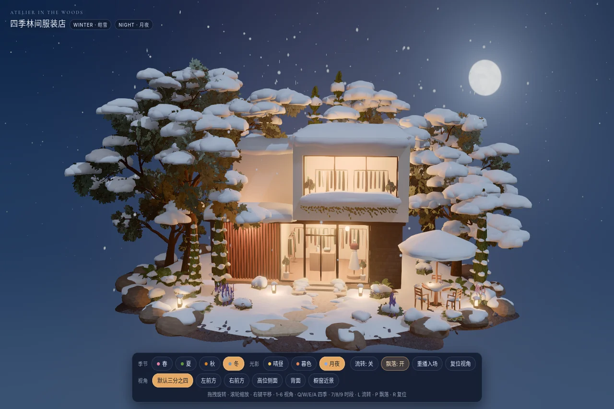
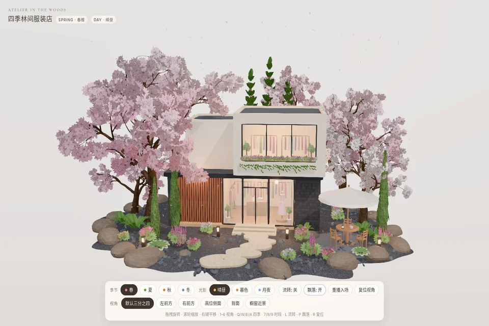
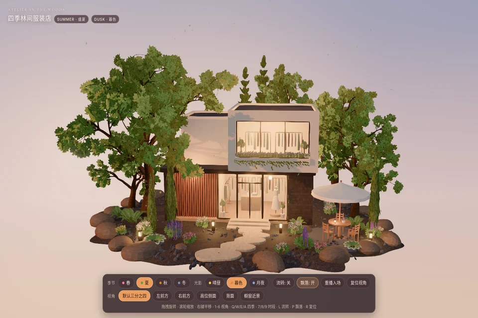
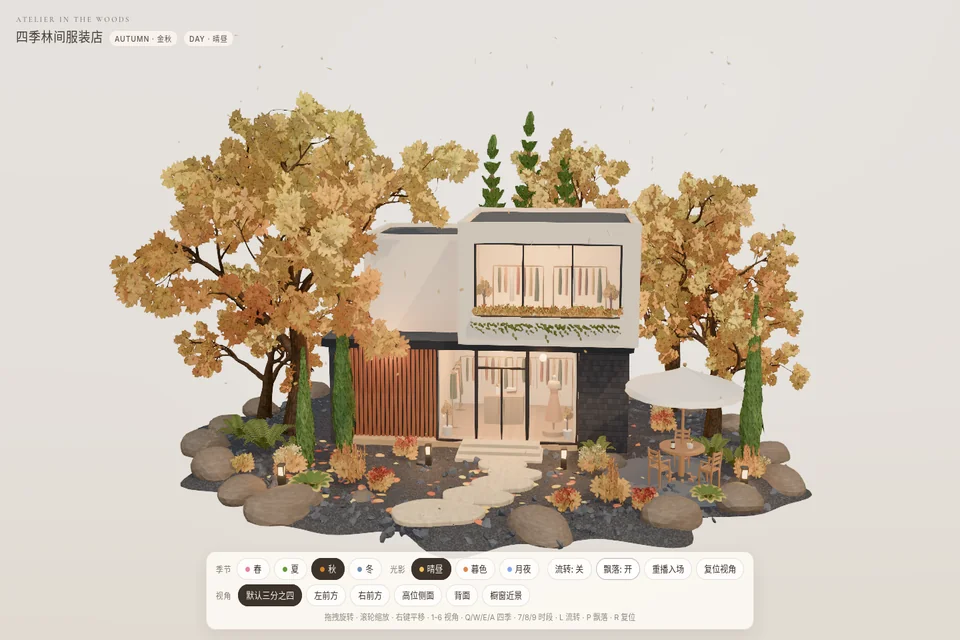
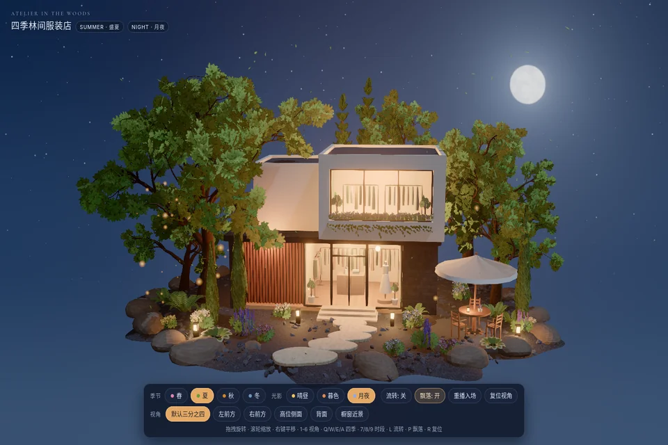
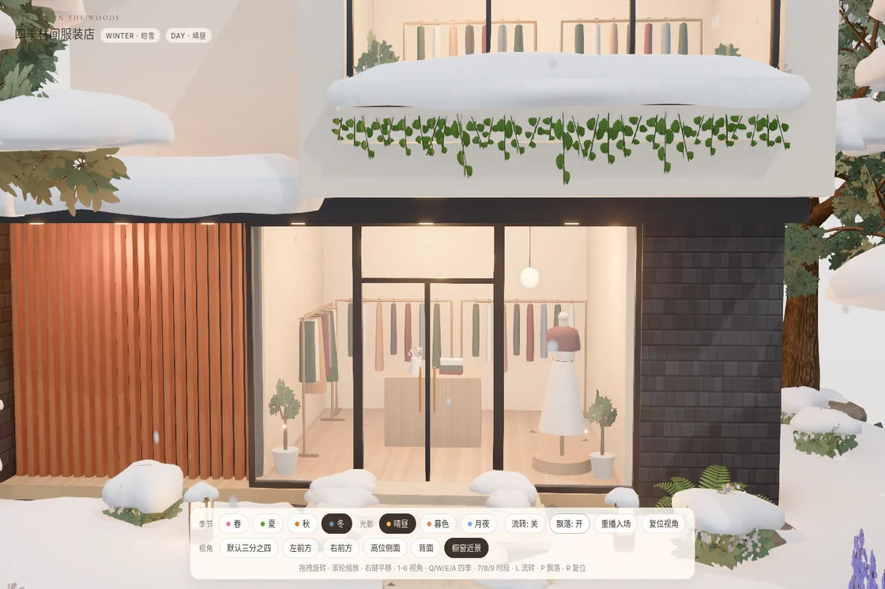

<div align="center">

# 四季林间服装店 · Atelier in the Woods

**基于 Three.js + Vite 的实时 3D 微缩精品店交互展示应用**

[](https://ada20204.github.io/four-seasons-forest-shop/)
[](https://github.com/ada20204/four-seasons-forest-shop/actions/workflows/ci.yml)
[](https://github.com/ada20204/four-seasons-forest-shop/actions/workflows/deploy-pages.yml)
[](https://threejs.org/)
[](./LICENSE)

[在线预览 (GitHub Pages)](https://ada20204.github.io/four-seasons-forest-shop/) · [快速运行](#快速开始) · [交互控制](#交互与url参数) · [工程架构](#工程架构)

<br />



</div>

---

## 四季风貌与昼夜流转

应用内置 **SPRING · 春樱 / SUMMER · 盛夏 / AUTUMN · 金秋 / WINTER · 皑雪** 四季状态与 **DAY · 晴昼 / DUSK · 暮色 / NIGHT · 月夜** 三个光影时段，共 `4 × 3 = 12` 种正交氛围组合，并支持平滑往复渐变。

<table>
  <tr>
    <td width="50%" align="center">
      
      <br />
      <sub><strong>SPRING · 晴昼春樱</strong> — 粉樱树冠、花境地被与 130 瓣飘落花瓣</sub>
    </td>
    <td width="50%" align="center">
      
      <br />
      <sub><strong>SUMMER · 暮色流金</strong> — 杏金天穹过渡、暖光挑檐与露台灯火初亮</sub>
    </td>
  </tr>
  <tr>
    <td width="50%" align="center">
      
      <br />
      <sub><strong>AUTUMN · 晴昼金秋</strong> — 金橙秋叶林冠与 125 片林间飘零秋叶</sub>
    </td>
    <td width="50%" align="center">
      
      <br />
      <sub><strong>SUMMER · 月夜萤火</strong> — 满月海月光、闪烁星野与 44 粒暖金萤火虫</sub>
    </td>
  </tr>
</table>

<p align="center">
  
  <br />
  <sub><strong>橱窗四季换装近景（WINTER · 皑雪）</strong> — 人台自动切换为象牙礼服 + <code>LatheGeometry</code> 酒红绒面肩部披肩，1F/2F 成衣挂架与收银台叠放毛衣同步换季</sub>
</p>

---

## 核心技术特性

- **100% 本地程序化 3D 场景生成**：微灰泥墙面、叠石砌体、竖向木格栅、砾石砂岩地面与植物 Alpha 贴图均在本地 Canvas2D 与几何模块离线生成，无任何外部第三方闭源模型或运行时 CDN 资源请求。
- **物理光影与空间昼夜轨线**：主光源与补光随太阳/月光弧线推移，联动线性 HDR 天穹、高天满月与星野视差、`RoomEnvironment` 夜间 IBL 收敛、`N8AOPostPass` 深靛环境光遮蔽、动态 `BloomEffect` 阈值以及 `ToneMappingMode.AGX` 色调映射。
- **橱窗四季真正换装（`updateWardrobe`）**：春樱柔粉薄纱裙、盛夏米麻轻纱、金秋焦糖廓形裙配浅驼披肩、皑雪象牙礼服配酒红绒面披肩（`capeWeight` 控制平滑显隐与垂坠比例），上下双层挂衣架与毛衣叠堆联动换色。
- **零额外 Draw Call GPU 微风系统**：通过着色器注入 `applyVertexBreeze`（绑定 `uTime` 与分季风力 `uWindStrength`，冬雪自动阻尼至 `0.42`），驱动阔叶树、针叶柏松、蕨类、薰衣草花穗与二楼垂蔓常春藤；配合茶桌烛火多谐波有机明暗微晃。
- **冬季连续厚雪与合批优化**：地面起伏雪被 + 屋顶/遮阳伞/桌面独立雪枕 + 多叶平滑树冠雪团；利用 `mergeTransformedGeometry` 与 `InstancedMesh` 将场景渲染稳定在 `907` Draw Calls 左右。
- **分层积木入场动画与响应式 HUD**：`AssemblyController` 分 4 个阶段构建岛屿、一层、二层与林木冬雪；底部玻璃态控制台在 `390×844` 窄屏下自动折叠为 `108px` 紧凑胶囊栏（占比 `14.2%`，零横向溢出）。

---

## 快速开始

### 环境要求

- **Node.js** `>= 20.0.0`（已测试 `v22.22.3`）
- **npm** `>= 10`

### 安装与运行

```bash
git clone https://github.com/ada20204/four-seasons-forest-shop.git
cd four-seasons-forest-shop
npm install
npm run dev
```

### 常用工程命令

| 命令 | 用途 |
| :--- | :--- |
| `npm run dev` | 启动 Vite 开发服务器（`127.0.0.1:4174`） |
| `npm run lint` | 运行 ESLint 静态检查 |
| `npm run format:check` | 检查 Prettier 代码格式规范 |
| `npm run build` | 按默认 `/forest-shop/` 基础路径构建到 `dist/`（可通过 `.env` / `VITE_BASE_PATH` 覆盖） |
| `npm run build:root` | 以根路径 `/` 构建生产产物（适合独立域名自托管） |
| `npm run build:gh-pages` | 以 `/four-seasons-forest-shop/` 构建 GitHub Pages 产物 |
| `npm run check` | 串行执行 `lint` + `format:check` + `build` 全量门禁 |
| `npm run verify:e2e` | 拉起 `vite preview` 并使用无头 Firefox + `geckodriver` 跑通多季节/昼夜/橱窗/移动端端到端验证 |

---

## 交互与 URL 参数

- **鼠标 / 触控**：左键拖拽旋转 · 滚轮缩放 · 右键平移
- **底部控制台**：四季切换（`春 / 夏 / 秋 / 冬`）、光影时段（`晴昼 / 暮色 / 月夜`）、昼夜自动流转、飘落开关、重播/跳过入场、视角预设（默认三分之四 / 左前方 / 右前方 / 高位侧面 / 背面 / 橱窗近景）
- **键盘快捷键**：
  - `1` – `6`：切换 6 组相机视角
  - `Q` / `W` / `E` / `A`（或 `[` / `]` / `←` / `→`）：切换春 / 夏 / 秋 / 冬
  - `7` / `8` / `9`：切换晴昼 / 暮色 / 月夜（`D` 循环切换）
  - `L` 开关自动流转 · `P` 开关季节粒子 · `R` 复位视角
- **URL 启动参数**：
  - `?season=spring|summer|autumn|winter`
  - `?time=day|golden|night`
  - `?cycle=1`（开启昼夜自动流转）
  - `?noIntro=1`（跳过积木入场动画）

---

## 工程架构

```text
four-seasons-forest-shop/
├── .github/workflows/
│   ├── ci.yml                     # PR 与 main 推送触发 lint + format + build 检查
│   └── deploy-pages.yml           # main 推送自动构建并发布到 GitHub Pages
├── assets/readme/                 # README 展示用精选 WebP 实拍截图
├── scripts/
│   └── verify-e2e.mjs             # 无头 Firefox + geckodriver 自动化端到端验证脚本
├── src/
│   ├── core/
│   │   ├── assemblyController.js  # 四阶段分层积木组装入场控制器
│   │   └── geometryUtils.js       # 几何变换合并批处理与实例化工具
│   ├── materials/
│   │   └── studioMaterials.js     # Canvas2D 程序化纹理、PBR 材质工厂与全局着色器 uniform
│   ├── scene/
│   │   ├── createBotanicalGarden.js   # 乔木、松柏、地被花园与 GPU 微风着色器注入
│   │   ├── createBoutiqueBuilding.js  # 双层精品店建筑、1F/2F 陈设与四季人台换装
│   │   ├── createIslandBase.js        # 砾石浮岛基底、景石护边与砂岩步石小径
│   │   ├── createOutdoorPatio.js      # 户外遮阳伞茶座与有机明暗微晃玻璃烛灯
│   │   ├── createSeasonalParticles.js # 樱花、落叶、飞雪与夏夜萤火虫粒子系统
│   │   ├── createWinterSnow.js        # 地面雪被、建筑屋顶/露台/树冠平滑雪枕
│   │   ├── lightingConfig.js          # Three.js / N8AO / Bloom / PMREM 渲染管线参数
│   │   ├── seasonPresets.js           # 四季色彩、风力阻尼与橱窗服饰配置表
│   │   └── timePresets.js             # 晴昼 / 暮色 / 月夜轨道光影与天穹配色插值预设
│   ├── main.js                    # 主渲染循环、交互控制、后期合成与调试钩子
│   └── style.css                  # 自适应玻璃态三时段主题 HUD 样式
├── .editorconfig
├── .env.example                   # VITE_BASE_PATH 基础路径配置示例
├── .prettierrc.json
├── eslint.config.mjs
├── index.html
├── LICENSE
├── package.json
└── vite.config.js                 # 子路径代理兼容、环境变量化 base 与 Rollup 分包配置
```

---

## 核心依赖与开源许可

| 依赖 | 版本 | 许可协议 | 作用 |
| :--- | :--- | :--- | :--- |
| `three` | `0.170.0` | MIT | WebGL 核心渲染、阴影与几何体构建 |
| `@dgreenheck/ez-tree` | `1.1.0` | MIT | 两侧主体落叶乔木树干与分枝点位程序化生成 |
| `n8ao` | `2.0.2` | ISC | 屏幕空间环境光遮蔽（SSAO） |
| `postprocessing` | `6.39.6` | Zlib | 后期合成、`BloomEffect`、`AGX` 色调映射与 `SMAAEffect` |
| `@fontsource/cormorant-garamond` | `5.3.0` | OFL-1.1 | 衬线标题展示字体（随包离线构建） |
| `@fontsource/inter` | `5.3.0` | OFL-1.1 | HUD 界面字体（随包离线构建） |

## 实测结果与已知边界

- **分包构建（`npm run check` / Vite `6.4.6`）**：业务主包已通过 `manualChunks` 独立拆分为 `index-*.js`（`115.91 kB`，gzip `39.41 kB`），与 `vendor-three`（`516.87 kB`）、`vendor-postfx`（`316.99 kB`）、`vendor-three-addons`（`20.98 kB`）及内嵌树叶贴图的 `vendor-eztree`（`3,998.25 kB`）分离缓存。
- **自动化验证（`npm run verify:e2e`，无头 Firefox WebGL）**：`errors: []`、`midAssemblyActive: true`、四季粒子与橱窗换装（含秋冬披肩显隐）全部断言通过，夏夜萤火虫 `44` 粒、流转进度正常推进并平稳收敛；`390×844` 窄屏下 HUD 高度 `108px`（占比 `14.2%`，无横向溢出），`calls: 907`、`triangles: 678,930`。
- **已知边界**：移动端视口数据基于桌面端无头浏览器 `390×844` 模拟测量，尚未在真机（iOS Safari / Android Chrome）实测双指触控手感与移动端 GPU 实际帧率；GPU 顶点微风与烛火明暗动画已校验着色器无报错编译及静态帧渲染，尚未单独录制动态视频帧比对。

本项目基于 [MIT License](./LICENSE) 开源。
